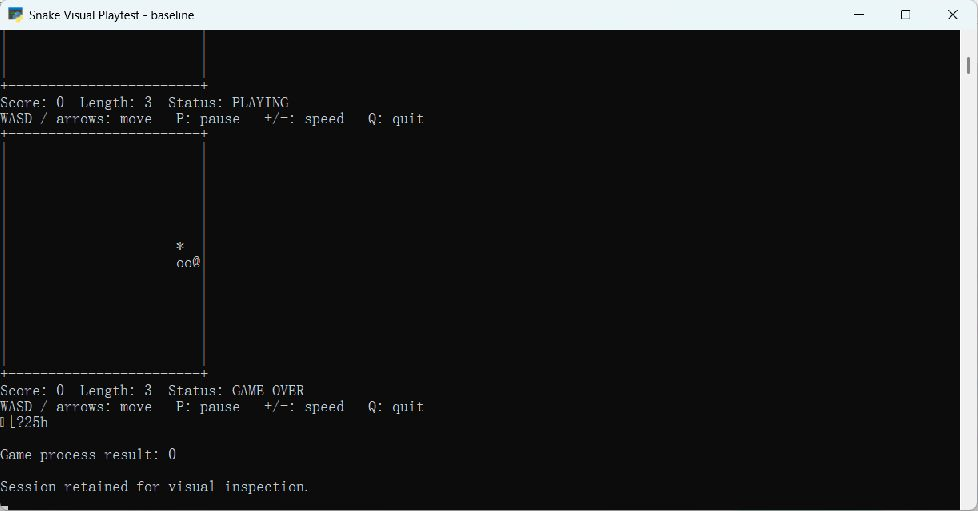
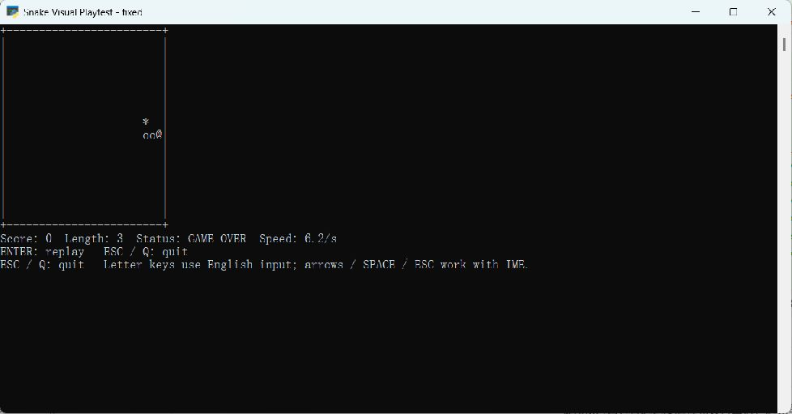
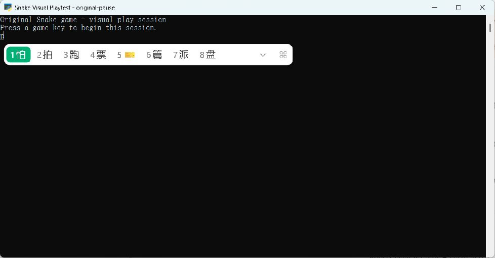
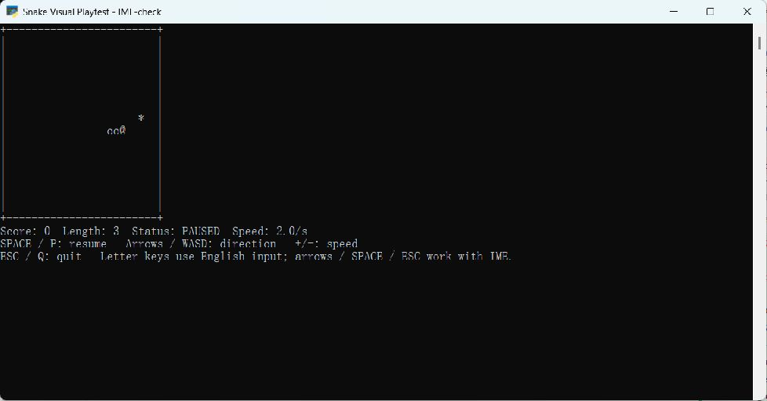
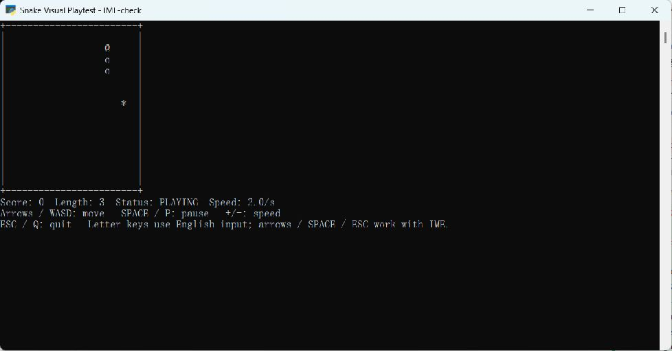
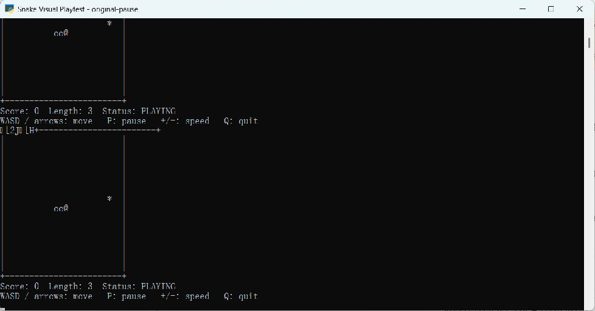
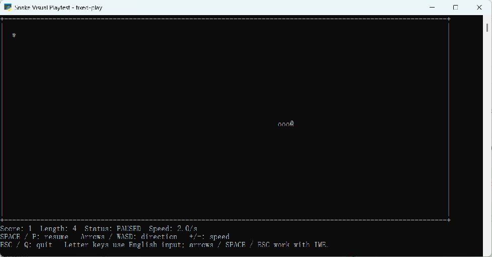
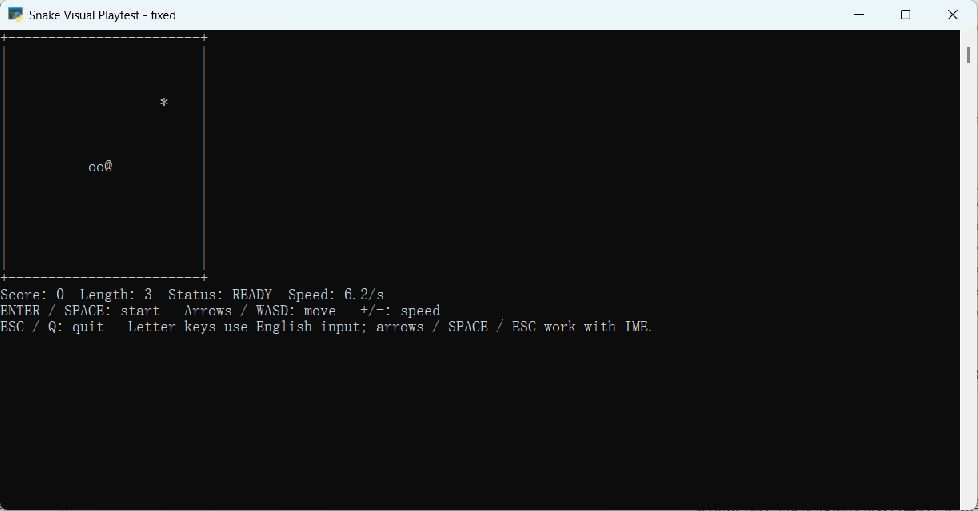
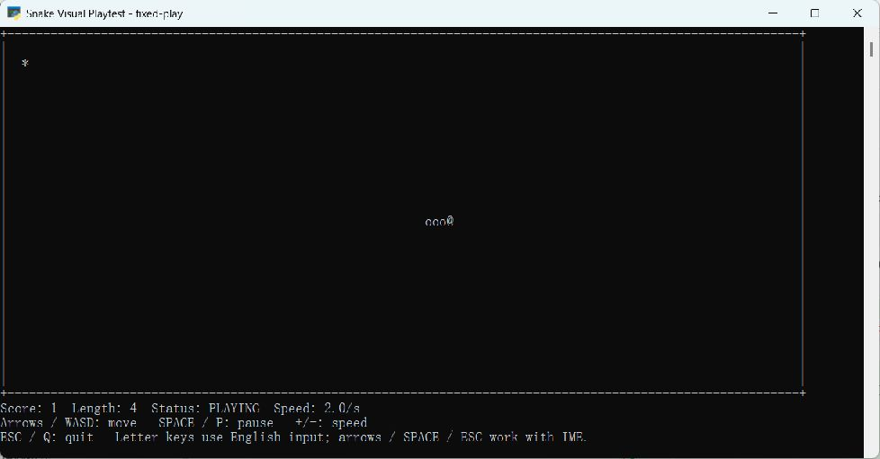
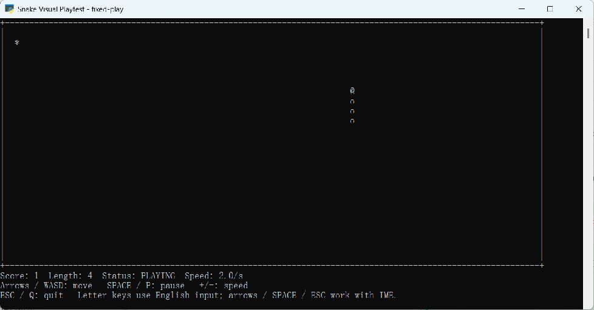

# 任务三实验报告：命令行贪吃蛇与真实游玩反馈

项目仓库：[luxiaoyu7548/task3-2026-10-28](https://github.com/luxiaoyu7548/task3-2026-10-28)

## 一、完成成果

本次选择任务三，使用 Python 标准库完成命令行贪吃蛇，实现连续移动、吃食物增长与加分、撞墙和自撞结束、分数显示等功能。随后打开真实游戏窗口，通过实际按键游玩，观察画面和操作反馈，发现问题后修改代码，再重新玩一遍确认效果。

最终版本加入等待开局、清晰的暂停提示、速度显示、中文输入环境下的替代控制键和撞墙后的重玩入口。代码保存在独立的 `snake/` 目录，附运行说明、18 项通过的自动化测试、25 张原始窗口截图及游玩记录。

## 二、实际怎样玩、怎样记录

我打开游戏后，先按空格开始，再用方向键控制蛇移动，尝试吃食物、转弯、暂停和恢复，并用减号与加速键调整速度。我一边玩，一边观察蛇身位置、食物、分数和状态提示；撞墙后按回车重玩，最后按 Esc 退出。遇到按键没有反应、画面滚动或暂停提示不清楚的问题时，我记录下当时的操作和截图，把具体问题反馈给 AI，让它协助修改代码。每次修改后，我再按相同的步骤试玩，确认问题是否解决。下面按我的实际游玩过程记录这些问题、反馈和修改结果。

默认棋盘用于检查开局、撞墙、重玩和中文输入环境下的控制；连续游玩使用下列参数：

```powershell
python snake/main.py --width 110 --height 24 --seed 242
```

该棋盘完整显示在实际窗口中。种子 242 正常生成的第一颗食物位于蛇头右前方一格，便于稳定复现吃食物后的画面。游玩时通过减号调至每秒 2 格，再操作转向、暂停和恢复。

## 三、从玩家视角发现的问题与修复

### 第一轮：棋盘向下滚动，结束时留着两份画面

**实际看到的问题：** 原版游玩后，窗口中不断追加棋盘；撞墙时上面仍显示 `PLAYING`，下面又出现一份 `GAME OVER`。画面还露出 `[2J`、`[H` 等控制字符，难以判断当前应该看哪一份棋盘。

**反馈要点：** 游戏画面应在固定位置更新；撞墙后保留一份清楚的最终结果，并让终端正确处理控制序列。

**怎样定位和修改：** 检查实际控制台配置，发现原始输出模式为 3，ANSI 处理没有开启。程序启动时增加 Windows 控制台 ANSI 配置，结束时恢复原模式；渲染改为回到同一屏幕位置更新，并清除各行旧文字和画面下方内容。结束状态也通过同一套渲染流程显示。

**重新游玩的结果：** 新版棋盘保持在同一位置，窗口不再不断追加棋盘；撞墙后只留一份 `GAME OVER` 和重玩提示，控制字符也不再露出。

| 原版实际画面 | 修复后重新游玩 |
| --- | --- |
|  |  |

### 第二轮：按 P 弹出中文候选词，游戏没有收到暂停键

**实际看到的问题：** 在中文输入状态下按 `P`，屏幕弹出了“怕、拍、跑”等候选词。按键被输入法用于拼音组合，游戏接收不到预期的暂停操作。这一现象直接说明了玩家感到“按键没反应”的原因。

**反馈要点：** 保留字母键的同时，提供方向键、空格、Esc 等替代控制，并把输入方式写在游戏画面上。

**怎样修改：** 增加空格开始、暂停和恢复，增加 Esc 退出；方向键负责移动。画面同时提示字母键使用英文输入，中文输入状态可以选择方向键、空格与 Esc。

**重新游玩的结果：** 再次调出中文候选框，按 Esc 取消候选后，保持中文输入环境，用空格实际完成开始、暂停和恢复；按上方向键后，蛇身从水平移动变为竖直移动；最后按 Esc，游戏正常退出并返回 0。

| 字母键被输入法截获 | 改用空格后成功暂停 |
| --- | --- |
|  |  |

中文输入环境下的转向结果：



### 第三轮：蛇已经停下，状态却仍写着 PLAYING

**实际看到的问题：** 原版按 P 后蛇停在原处，状态行仍然显示 `PLAYING`。仅看画面，容易把正常暂停误认为游戏卡住；调节速度时，画面也没有显示当前速度。

**反馈要点：** 暂停时明确显示 `PAUSED` 和恢复按键，调速时立即更新速度文字，让玩家能够确认操作是否生效。

**怎样修改：** 将暂停状态和移动间隔传入渲染层；状态行显示 `PAUSED`，操作行改为 `SPACE / P: resume`，并增加 `Speed`。暂停时保持蛇身位置，恢复后继续移动。

**重新游玩的结果：** 连续游玩得到 1 分后按空格，画面显示 `Score: 1`、`Length: 4` 和 `PAUSED`。间隔后再次观察，蛇身仍在同一位置；恢复后按方向键转弯，蛇继续移动。按减号后速度降到 `2.0/s`，按加速键后立即显示 `2.1/s`。

| 原版暂停仍显示 PLAYING | 新版明确显示 PAUSED |
| --- | --- |
|  |  |

### 第四轮：补齐开局等待与结束后的重玩操作

**游玩中的改进点：** 初版启动后立刻移动，撞墙后结束当前游戏。重新游玩时，需要更清楚的开局节奏和再来一局的入口。

**反馈要点：** 开局先显示棋盘与操作说明，等待玩家确认；撞墙后展示结果，并提供重玩按键。

**怎样修改：** 增加 `READY` 状态，按回车或空格开始；结束画面显示 `ENTER: replay`，按回车重置分数和蛇长，返回等待开局状态。

**重新游玩的结果：** 打开新版窗口时，蛇保持不动，状态为 `READY`。按空格后开始移动；撞墙后窗口保留结果；按回车后回到 `Score: 0`、`Length: 3`、`READY`，可以开始下一局。



## 四、一局连续游玩的实际结果

在 `110×24` 棋盘、种子 242 下完成以下操作：

| 操作顺序 | 实际看到的结果 | 截图编号 |
| --- | --- | --- |
| 开局前反复按减号 | 速度显示降到 `2.0/s`，蛇保持等待状态 | 09 |
| 按空格开始 | 蛇向右移动并吃到食物，显示 `Score: 1 / Length: 4` | 10 |
| 按空格暂停 | 明确显示 `PAUSED`，分数和蛇长保留 | 11 |
| 等待后再次观察 | 蛇身保持在相同位置 | 12 |
| 选择向上并恢复 | 蛇实际向上移动，蛇身呈竖直排列 | 13 |
| 再次暂停 | 状态回到 `PAUSED` | 14 |
| 选择向左并恢复 | 蛇头转为向左，蛇身变为水平排列 | 16 |
| 再次暂停后按加速键 | 速度由 `2.0/s` 变为 `2.1/s` | 17、18 |
| 得分后按 Esc | 正常退出，窗口记录显示返回值 `0` | 19 |

真实吃食物后的画面：



随后向上、向左转弯的实际画面：

| 向上移动 | 向左移动 |
| --- | --- |
|  |  |

全部 25 张截图与操作索引见[窗口游玩记录](../实验结果/窗口游玩记录.md)。

## 五、Using Superpowers 的应用

本任务使用 Using Superpowers，将实际观察、问题定位、测试先行和完成前验证结合起来：先玩游戏、记录可见问题与按键过程，再定位代码原因；修改前添加对应回归测试，修改后同时重跑测试和重新游玩。

| 流程 | 本轮实际执行 |
| --- | --- |
| 复现与记录 | 打开原版窗口，记录滚屏、中文候选框和暂停显示问题 |
| 明确反馈 | 描述具体按键、实际画面与希望得到的结果 |
| 定位原因 | 核对控制台模式、按键处理、状态渲染和结束流程 |
| 测试先行 | 为暂停提示、开局提示、速度显示、空格暂停、Esc 退出和重玩建立回归依据 |
| 修改后验证 | 18 项自动化测试通过，并在真实窗口重玩、转向、得分、暂停、重玩和退出 |

## 六、实践收获

本轮游玩将“按键没反应”“暂停像卡住”“画面一直滚动”等体验转化为具体、可复现的反馈。记录按键前后的画面，能把问题定位到输入法、终端配置或状态显示；修复后再按同样的键、看同样的画面，能够确认玩家体验已经发生改变。

最终交付既包含游戏代码，也保留了实际游玩中的问题画面、反馈要点、修改说明和重新游玩的结果，形成完整的反馈循环。

## 附录 A：环境与记录方式

- 环境为 Windows、PowerShell、Python 3.13.15；游戏使用 Python 标准库。
- 本轮通过 Computer Use 向真实游戏窗口发送按键并读取窗口截图，操作由 AI 完成。早期 PTY 记录另保存在历史摘要中。
- 截图保存为原始 JPEG。截图中的 `Session retained for visual inspection` 来自截图辅助启动器，用于游戏退出后保留窗口；实际游戏仍执行项目的 `snake/main.py` 入口。
- 报告中的反馈要点按实际现象和修改要求整理。完整截图文件、文件校验和操作索引位于 `实验结果/`。

## 附录 B：早期代码开发中的反馈记录

1. **自撞测试场景：** 首次测试将目标放在即将腾出的尾格，得到 `AssertionError: False is not true`。检查坐标后，将 4 格蛇身改为 5 格，使目标落到身体中段，7 项规则测试通过。
2. **入口重复渲染：** 检查发现 `main()` 与交互循环重复承担首帧输出，增加入口回归测试后移除入口中的 `print(render(state))`，当时 11 项测试通过。
3. **分数被当成退出码：** 得 1 分后按 Q 返回 1，回归测试得到 `AssertionError: 1 != 0`。将分数显示与进程状态分开，正常退出返回 0，当时 12 项测试通过。本轮又实际验证了得分后按 Esc 返回 0。
4. **初始满盘：** `3×1` 棋盘已被初始蛇占满，状态仍为进行中。增加满盘判断后，立即进入胜利状态，测试增至 13 项并通过。
5. **本轮游玩修复：** 在上述基础上增加 5 项交互回归测试，最终完整套件共 18 项，全部通过。

## 附录 C：复现命令与附件

```powershell
python snake/main.py
python snake/main.py --width 110 --height 24 --seed 242
python -m unittest discover -s snake/tests -v
python snake/main.py --demo --seed 7
python -m compileall snake
```

固定演示输出：

```text
DEMO seed=7 steps=4 score=1 length=4 status=playing
```

- `snake/`：源代码、测试、运行说明和项目工作规则。
- `报告（word+md）/任务三实验报告.md`、`任务三实验报告.docx`：内容一致的 Markdown 与 Word 报告。
- `实验结果/游玩截图/`：25 张实际窗口截图。
- `实验结果/窗口游玩记录.md`、`窗口游玩记录.json`：操作索引、场景参数和截图校验信息。
- `实验结果/` 中其他文件：自动化检查的 stdout、stderr、退出码及历史交互摘要。
- `文件清单与校验.json`：提交文件大小和 SHA-256 校验。
